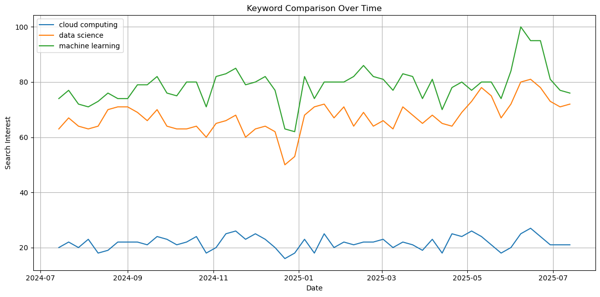
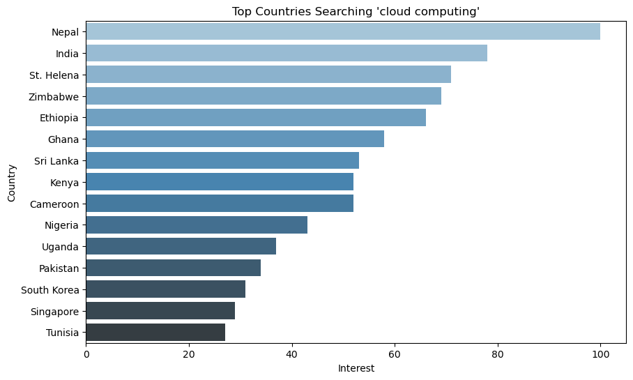
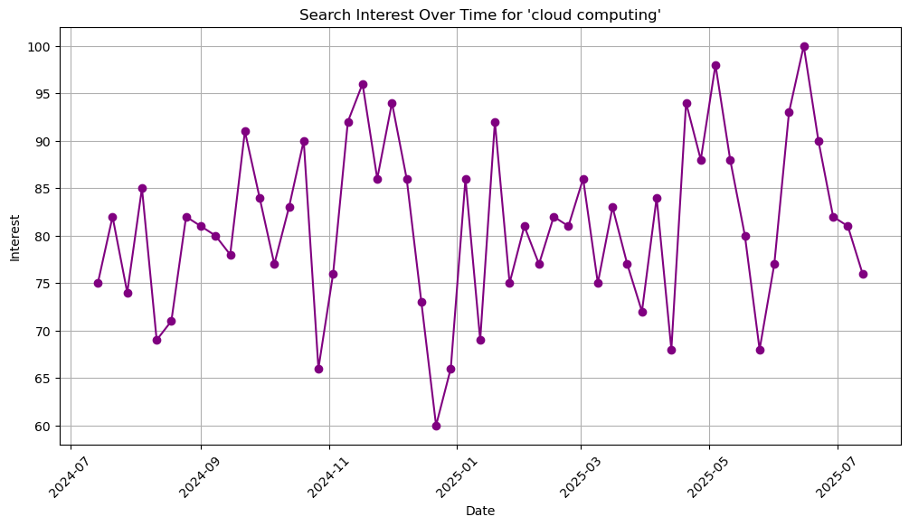

# 🔎 Google Trends Analysis with Python

**Using the PyTrends API to measure global search interest in "cloud computing", "data science" and "machine learning" over 12 months (July 2024 – July 2025): where the demand is, how it changes over time, and how the three topics compare.**




---

## 🎯 Why it matters

Search interest is a free, real-time signal of demand. Training providers, recruiters, cloud vendors and marketers can use it to decide **where** to focus (which countries) and **when** to run campaigns (seasonal peaks and dips).

---

## 📌 Findings

### 1. Which countries search most for "cloud computing"?

**Nepal (100), India (78), St. Helena (71), Zimbabwe (69) and Ethiopia (66)** lead the list. South and Southeast Asia and Africa make up most of the top 15.

Google Trends scores interest *relative to each country's total search volume*, so this list shows where cloud computing is a large **share** of searches, not where the most searches happen. That points to emerging tech-education and outsourcing markets. Very small countries (e.g. St. Helena) can rank high because of small sample sizes. The US does not appear in the top 15.



### 2. How does interest in "cloud computing" change over time?

Weekly interest moves between **60 and 100**, with no long-term decline. It hits its **low in late December 2024** (the holiday dip) and **peaks in mid-June 2025**. The timing likely reflects academic and hiring calendars.



### 3. How do the three topics compare?

- **"Machine learning" is searched the most:** about 3–4× more than "cloud computing" on the same scale
- **"Data science" is a close second** and moves almost in step with machine learning
- **All three dip together in late December and peak together in June 2025**, which suggests a shared audience of students and job seekers

**Takeaway:** campaigns for tech courses or hiring do best in late spring and early summer, and worst over the winter holidays.

---

## 🧰 Tools & libraries

| Tool | Use |
|---|---|
| **PyTrends** | Unofficial Google Trends API: interest by region and over time |
| **pandas** | Reshaping and sorting the results |
| **Matplotlib / Seaborn** | Bar and line charts |
| **Plotly Express** | Interactive world choropleth map |

---

## ▶️ How to run

```bash
git clone https://github.com/1998-aish/Google-Data-Analysis-using-Python.git
cd Google-Data-Analysis-using-Python
pip install -r requirements.txt
jupyter notebook notebooks/google_trends_analysis.ipynb
```

Change the `keyword` variable to analyze any search term.

> **Note:** the notebook pulls **live** data, so a new run covers the latest 12 months and the numbers will differ from the snapshot above (captured July 2025). PyTrends is an unofficial API and Google may rate-limit requests; if that happens, wait a few minutes and re-run.

---

## 📁 Repository structure

```
Google-Data-Analysis-using-Python/
├── notebooks/
│   └── google_trends_analysis.ipynb   # data pull, analysis and charts
├── images/                            # chart snapshots used in this README
├── requirements.txt
└── README.md
```

---

## 🔭 Next steps

- Compare regional interest *within the US* by state to find local hiring hotspots
- Add more keywords (e.g. "generative AI", "SQL") and correlate interest with job-posting volume
- Forecast interest with a time-series model (e.g. Prophet)

---

## 👩‍💻 Author

**Aishwarya Srivastava**: M.S. Data Science & Analytics, Arizona State University
[LinkedIn](https://www.linkedin.com/in/aish-sv123) · [GitHub](https://github.com/1998-aish)
